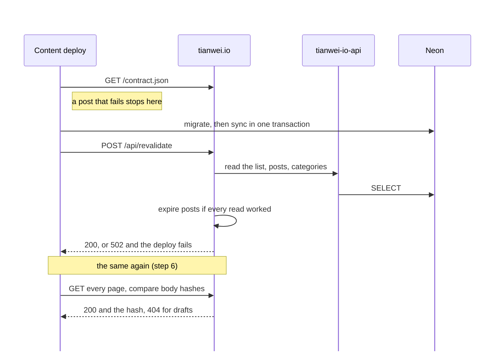

<!-- markdownlint-disable MD007 MD033 MD041 -->
<samp>
<h1>tianwei-io-content</h1>

[](https://github.com/notbd/tianwei-io-content/actions/workflows/deploy-content.yml)

The content engine of my personal website [tianwei.io](https://tianwei.io).

<h2>Stack</h2>

- **Runtime**: [Node.js](https://nodejs.org) + [TypeScript](https://www.typescriptlang.org)
- **ORM**: [Drizzle ORM](https://orm.drizzle.team)
- **Database**: [PostgreSQL](https://www.postgresql.org)
- **Remote DB Host**: [Neon](https://neon.com)
- **Content Format**: [MDX](https://mdxjs.com) files with frontmatter
- **Testing and local database**: [Vitest](https://vitest.dev) + [PGlite](https://pglite.dev) (Postgres in the Node process)
- **Infrastructure**: [GitHub Actions](https://docs.github.com/en/actions) (CI + remote sync)

<h2>Site Architecture</h2>

This is the content engine, one of the three repos behind the site, next to the [frontend](https://github.com/notbd/tianwei.io) and the [API](https://github.com/notbd/tianwei-io-api). How the three fit together, with a diagram, is in [the frontend's README](https://github.com/notbd/tianwei.io/blob/main/README.md).

<h2>How It Works</h2>

This repo owns the posts, the database schema and every write; the API only reads. A sync (`src/sync.ts`) makes the `posts` table match the files in `content/`:

- **Validate first**: every file is parsed before the database is touched, and one invalid file stops the run. Frontmatter is YAML only (a `---js` fence is refused before anything in it runs) and follows a strict schema (a misspelled key such as `updateAt` is an error, not ignored); titles and descriptions must be valid XML text, and neither the author nor the body may contain NUL. The MDX body is parsed with the syntax the frontend uses (MDX with GFM) and may contain no JavaScript, which the frontend refuses to run. Errors name the file and line.
- **Checked against the frontend**: `pnpm check:contract` holds every post, drafts included, to the frontend's [`/contract.json`](https://tianwei.io/contract.json): the components a post may use and their attributes, and the time zone dates are anchored to. Pull requests run it, and the deploy runs it before writing anything ([tianwei.io ADR-0006](https://github.com/notbd/tianwei.io/blob/main/docs/adr/0006-cross-repo-releases.md)).
- **One transaction**: posts are upserted by slug, so ids stay stable, and rows whose files are gone are deleted. Readers never see a half-synced table ([ADR-0001](./docs/adr/0001-transactional-reconcile-sync.md)).
- **Guard rails**: concurrent syncs wait on a Postgres advisory lock, and a sync that would leave no published post is refused unless `--allow-empty` is passed, so a bad checkout cannot empty production. `--allow-empty` only lets the sync through: the frontend still refuses to build, and the API's deploy check still fails, without a published post.
- **No production database by accident**: `DATABASE_URL` is read only from the process environment. Every entry point that reads `.env.local` goes through `loadLocalEnv()` (`src/env.ts`), which refuses a file that sets it: local development never reads the variable, but `pnpm db:migrate` and `pnpm sync:prod` do, and would use that database without being told to. A `.env` that sets it is refused too: `drizzle-kit` loads that file by itself, so the migration would still reach that database.
- **Dates**: `createdAt` and `updatedAt` are calendar dates in `America/New_York`, stored as that day's midnight there, whatever the machine's time zone ([ADR-0003](./docs/adr/0003-content-time-zone.md)).
- **Migrations**: the schema is in `drizzle/`, and the migration history is committed and applied by the deploy, never generated on the fly ([ADR-0002](./docs/adr/0002-committed-migration-history.md)).

<h2>Writing a Post</h2>

```shell
pnpm new-post "My Post Title"          # creates content/articles/my-post-title.mdx
pnpm new-post "My Post Title" notes    # in another category
```

The folder name is the category and the filename is the slug, unique across categories. A new post starts as a draft, with frontmatter that already passes the parser:

| Key | Required | Value |
| --- | --- | --- |
| `title` | yes | The post title |
| `description` | no | One sentence for the post list, the feed and link previews |
| `createdAt` | yes | Publish date, `yyyy-MM-dd` |
| `updatedAt` | no | Last meaningful update, `yyyy-MM-dd`, not before `createdAt` |
| `author` | yes | Author name |
| `isPublished` | yes | `false` keeps the post off the site |

The body is Markdown plus the components the frontend lists in its [`/contract.json`](https://tianwei.io/contract.json), with string attributes; no JavaScript and no other JSX. Today that is `<MdxImage>`, for images hosted on Cloudinary, and `<Link>`, for links within the site:

```mdx
<MdxImage src="<cloudinary-id>" alt="..." width="1024" height="768" title="A caption" sizeCategory="xl" />

See <Link href="/posts">every post</Link>.
```

`title` (a caption under the image) and `sizeCategory` (the image's maximum width, `sm` to `3xl`, `lg` by default) are optional; the contract is the authority. Open a pull request: CI parses every post and checks it against the contract (`pnpm check:contract`), so a broken one fails there and not in production. Merging to `main` syncs it; it shows on the site once `isPublished` is `true`, and until then the frontend's draft preview can show it.

<h2>Layout</h2>

| Path | Purpose |
| --- | --- |
| `content/{category}/{slug}.mdx` | The posts |
| `src/` | Parsing and validation, the contract check, the transactional sync, the file watcher, the deploy's calls to the frontend, the local database and its endpoint |
| `drizzle/` | Database schema and the committed migration history (`migrations/`) |
| `scripts/` | Thin CLI entry points behind the `pnpm` scripts; `rehearse.ts` is the exception, it orchestrates the three checkouts |
| `tests/` | Unit tests, and integration tests (migrations, sync, watcher, the database endpoint) on PGlite |

<h2>Local Run</h2>

Prerequisites: **Node.js 26** (see `.nvmrc`) and **pnpm 10**. No Docker, and no database to install.

```shell
git clone git@github.com:notbd/tianwei-io-content.git
cd tianwei-io-content
pnpm install

# Build the database in memory from the migrations, sync every post, then re-sync on each save
pnpm dev
```

The database lives in this process and is rebuilt from the files on every start ([ADR-0004](./docs/adr/0004-in-process-local-database.md)). `pnpm dev` serves it on `127.0.0.1:5431`, where the API's `wrangler dev` reads it with its production driver. The whole site on one machine is three terminals:

| Checkout | Command | Listens on |
| --- | --- | --- |
| this repo | `pnpm dev` | `127.0.0.1:5431` (the database endpoint) |
| [tianwei-io-api](https://github.com/notbd/tianwei-io-api) | `pnpm dev`, with the `DATABASE_URL` its `.dev.vars.example` gives | `127.0.0.1:8787` |
| [tianwei.io](https://github.com/notbd/tianwei.io) | `CONTENT_API_URL=http://127.0.0.1:8787 pnpm dev` | `localhost:3000` |

With `FRONTEND_URL=http://localhost:3000` in `.env.local`, and the same `REVALIDATION_SECRET` as the frontend's, every sync also expires that frontend's cache, so a reload shows the save.

| Script | Purpose |
| --- | --- |
| `pnpm dev [--allow-empty]` | The local database, its endpoint, a sync, and a re-sync on each save |
| `pnpm rehearse [--keep]` | Rehearse a release against the three checkouts on this machine (below) |
| `pnpm new-post "Title" [category]` | Scaffold a draft (`isPublished: false`, today's date in `America/New_York`) that already passes the parser; refuses a slug any post already has |
| `pnpm sync:prod` | Sync the database `DATABASE_URL` names, set for this one command (`DATABASE_URL=... pnpm sync:prod`); stops without it. The deploy runs it against production |
| `pnpm db:generate` / `db:migrate` | Generate a migration from schema changes / apply pending migrations to the database `DATABASE_URL` names |
| `pnpm check:contract [--require]` | Check every post, drafts included, against the frontend's `/contract.json`; without `--require`, a frontend with no contract to give only warns |
| `pnpm frontend:revalidate` | Revalidate the frontend twice, then reconcile: every page must answer and each post page must show the body synced here |
| `pnpm lint` / `typecheck` / `test` | Quality gates (same as CI) |

<h3>Rehearsing a release</h3>

`pnpm rehearse` plays a content deploy against the three checkouts as they are on disk: this one, `../tianwei-io-api` and `../tianwei.io` (or `API_DIR` and `WEB_DIR`), each with its dependencies installed. It starts the database, the API (`wrangler dev`) and a production build of the frontend on ports it picks, then runs the deploy's own code through eight scenarios: the contract check, a sync, a reconcile that must fail before the cache is expired and pass after, a new post, an API that cannot read the database, a post that passes the contract but fails to render, and the way back. It cannot reach production: the three services listen on `127.0.0.1` only, both secrets are made up for the run, and it loads neither this repo's `.env.local` nor the API's `.dev.vars`. `next build` still loads the frontend checkout's own env files, but the rehearsal sets the API address and both secrets over them.

- **It needs the frontend's checkout to itself.** It runs `next build` there, so from its start until it ends (or, with `--keep`, until it holds the stack) nothing else may use that checkout's `.next`: no `next start`, screenshots or e2e. A lock in `.next/cache` keeps a second rehearsal out, and only that. The build needs `NEXT_PUBLIC_CLOUDINARY_CLOUD_NAME`, from the environment or that checkout's `.env.local`.
- **`--keep`** holds the stack after every scenario passed and prints its addresses, both secrets and a draft's slug, for a manual pass or the frontend's e2e suite. The frontend's address is printed as `localhost`: Next rewrites `127.0.0.1` to `localhost` in its redirects, so the draft preview works only when the browser starts there.
- **Stopping**: Ctrl-C asks for a stop, and the run cleans up after itself (its children, the lock, its temporary directory). A step that runs the deploy's own code (a sync, the contract check, a revalidation, a reconcile) is not interrupted, and the run stops right after it. Locally that is a few seconds; against a frontend that hangs it is as long as that step's requests take to time out: 60 s for a contract check or a revalidation, three minutes or more for a reconcile. `kill -9 <pid>` ends it at once; the next rehearsal then refuses to start and prints what was left behind and how to clear it.

The exit code is 0 only when every scenario passed.

<h2>Configuration</h2>

| Variable | Purpose |
| --- | --- |
| `DATABASE_URL` | A remote database for one command, from the process environment only (`DATABASE_URL=... pnpm sync:prod`); a `.env.local` or `.env` that sets it is refused. Only `pnpm sync:prod` and `pnpm db:migrate` connect to it, and both stop without it; `pnpm dev` and `pnpm rehearse` never do |
| `REVALIDATION_SECRET` | Bearer token for the frontend's `/api/revalidate` (must match the frontend's) |
| `FRONTEND_URL` | A frontend on this machine, such as `http://localhost:3000`. `pnpm dev` expires its cache after every sync (only when the host is `localhost` or `127.0.0.1`), and `pnpm check:contract` and `pnpm frontend:revalidate` talk to it; unset, those two use `https://tianwei.io`. `pnpm rehearse` does not read it |

`.env.example` explains each one; `pnpm dev` needs none of them. The deploy workflow reads two repository secrets: `PROD_REMOTE_DATABASE_URL`, passed as `DATABASE_URL`, and `REVALIDATION_SECRET`.

<h2>Quality Gates</h2>

```shell
pnpm lint
pnpm typecheck
pnpm test   # unit tests; migrations, sync, watcher and the database endpoint on PGlite
```

CI (`.github/workflows/ci.yml`) runs these on every pull request, then `pnpm check:contract` against the production frontend (the script table above says when it only warns).

<h2>Deploy</h2>

A push to `main` that touches content or sync code runs `.github/workflows/deploy-content.yml`:

1. Run lint, typecheck and tests again.
2. Stop if the files it deploys differ from the head of `main`: re-running an old deploy would roll content back, so revert instead.
3. Check every post, drafts included, against the frontend's `/contract.json` (`pnpm check:contract --require`). A post that fails, or a frontend with no contract to give, stops the deploy here with the database untouched.
4. Apply pending migrations (`drizzle-kit migrate`).
5. Sync every post to Neon in one transaction.
6. Revalidate the frontend: it reads the content through the API and expires its cache only when every read works. Anything but a 200 fails the deploy, and the site stays as it was (the statuses are in [the frontend's README](https://github.com/notbd/tianwei.io/blob/main/README.md), Revalidation API). Revalidate again a minute later, for any page that was rendering during the sync.
7. Reconcile: parse the posts once, then check the frontend against them:
   - the sitemap lists exactly the published posts;
   - every URL in the sitemap answers 200, and each post page carries exactly one `post-body-sha256` tag, equal to the hash of the body synced in step 5, so a page still showing its previous version fails the deploy;
   - `/feed.xml` and every published post's `/opengraph-image` answer 200;
   - every draft's `/posts/<slug>` answers 404.

   Each request has 60 s, the whole body included. A round collects every problem; if there is any, the round runs again 5 s later, three rounds in all. A failure names the URL and whether it answered an error, timed out or still shows a previous version (with the expected and the reported hash); the log keeps `x-vercel-cache` and `age` for every request.



Deploys run one at a time, so two syncs never interleave. What each check proves, and what it does not, is in [tianwei.io ADR-0006](https://github.com/notbd/tianwei.io/blob/main/docs/adr/0006-cross-repo-releases.md). A change that spans repos ships in the order that ADR sets, and is rehearsed first per [`release-verification.md`](https://github.com/notbd/tianwei.io/blob/main/docs/release-verification.md).

<h2>License</h2>

Source code is licensed under <a href='./LICENSE'>AGPLv3</a>.<br>
The posts under <code>content/</code> are licensed under <a href='https://creativecommons.org/licenses/by-nc-sa/4.0/'>CC BY-NC-SA 4.0</a>.
</samp>
