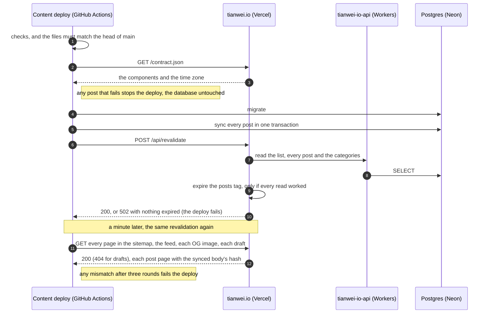

<!-- markdownlint-disable MD007 MD033 MD041 -->
<samp>
<h1>tianwei-io-content</h1>

[](https://github.com/notbd/tianwei-io-content/actions/workflows/deploy-content.yml)

The content engine of my personal website [tianwei.io](https://tianwei.io).

<h2>Stack</h2>

- **Runtime**: [Node.js](https://nodejs.org) + [TypeScript](https://www.typescriptlang.org)
- **ORM**: [Drizzle ORM](https://orm.drizzle.team)
- **Database**: [PostgreSQL](https://www.postgresql.org)
- **Remote DB Host**: [Neon](https://neon.com)
- **Content Format**: [MDX](https://mdxjs.com) files with frontmatter
- **Testing**: [Vitest](https://vitest.dev) + [PGlite](https://pglite.dev) (in-memory Postgres)
- **Infrastructure**: [Docker](https://www.docker.com) Compose (local Postgres), [GitHub Actions](https://docs.github.com/en/actions) (CI + remote sync)

<h2>Site Architecture</h2>

This is the content engine, one of the three repos behind the site, next to the [frontend](https://github.com/notbd/tianwei.io) and the [API](https://github.com/notbd/tianwei-io-api). How the three fit together, with a diagram, is in [the frontend's README](https://github.com/notbd/tianwei.io/blob/main/README.md).

<h2>How It Works</h2>

This repo owns the posts, the database schema and every write; the API only reads. A sync (`src/sync.ts`) makes the `posts` table match the files in `content/`:

- **Validate first**: every file is parsed before the database is touched, and one invalid file stops the run. Frontmatter is YAML only (a `---js` fence is refused before anything in it runs) and follows a strict schema (a misspelled key such as `updateAt` is an error, not ignored); titles and descriptions must be valid XML text, and neither the author nor the body may contain NUL. The MDX body is parsed with the syntax the frontend uses (MDX with GFM) and may contain no JavaScript, which the frontend refuses to run. Errors name the file and line.
- **Checked against the frontend**: `pnpm check:contract` holds every post, drafts included, to the frontend's [`/contract.json`](https://tianwei.io/contract.json): the components a post may use and their attributes, and the time zone dates are anchored to. Pull requests run it, and the deploy runs it before writing anything ([tianwei.io ADR-0006](https://github.com/notbd/tianwei.io/blob/main/docs/adr/0006-cross-repo-releases.md)).
- **One transaction**: posts are upserted by slug, so ids stay stable, and rows whose files are gone are deleted. Readers never see a half-synced table ([ADR-0001](./docs/adr/0001-transactional-reconcile-sync.md)).
- **Guard rails**: concurrent syncs wait on a Postgres advisory lock, and a sync that would leave no published post is refused unless `--allow-empty` is passed, so a bad checkout cannot empty production. `--allow-empty` only lets the sync through: the frontend still refuses to build, and the API's deploy check still fails, without a published post.
- **No production database by accident**: `DATABASE_URL` is read only from the process environment. A `.env.local` that sets it is refused by every script, since they all read that file and `pnpm dev:up` would migrate that database and write every save to it.
- **Dates**: `createdAt` and `updatedAt` are calendar dates in `America/New_York`, stored as that day's midnight there, whatever the machine's time zone ([ADR-0003](./docs/adr/0003-content-time-zone.md)).
- **Migrations**: the schema is in `drizzle/`, and the migration history is committed and applied by the deploy, never generated on the fly ([ADR-0002](./docs/adr/0002-committed-migration-history.md)).

<h2>Writing a Post</h2>

```shell
pnpm new-post "My Post Title"          # creates content/articles/my-post-title.mdx
pnpm new-post "My Post Title" notes    # in another category
```

The folder name is the category and the filename is the slug, unique across categories. A new post starts as a draft, with frontmatter that already passes the parser:

| Key | Required | Value |
| --- | --- | --- |
| `title` | yes | The post title |
| `description` | no | One sentence for the post list, the feed and link previews |
| `createdAt` | yes | Publish date, `yyyy-MM-dd` |
| `updatedAt` | no | Last meaningful update, `yyyy-MM-dd`, not before `createdAt` |
| `author` | yes | Author name |
| `isPublished` | yes | `false` keeps the post off the site |

The body is Markdown plus the components the frontend lists in its [`/contract.json`](https://tianwei.io/contract.json), with string attributes; no JavaScript and no other JSX. Today that is `<MdxImage>`, for images hosted on Cloudinary, and `<Link>`, for links within the site:

```mdx
<MdxImage src="<cloudinary-id>" alt="..." width="1024" height="768" title="A caption" sizeCategory="xl" />

See <Link href="/posts">every post</Link>.
```

`title` (a caption under the image) and `sizeCategory` (the image's maximum width, `sm` to `3xl`, `lg` by default) are optional; the contract is the authority. Open a pull request: CI parses every post and checks it against the contract (`pnpm check:contract`), so a broken one fails there and not in production. Merging to `main` syncs it; it shows on the site once `isPublished` is `true`, and until then the frontend's draft preview can show it.

<h2>Layout</h2>

| Path | Purpose |
| --- | --- |
| `content/{category}/{slug}.mdx` | The posts |
| `src/` | Parsing and validation, the contract check, the transactional sync, the file watcher, the deploy's calls to the frontend |
| `drizzle/` | Database schema and the committed migration history (`migrations/`) |
| `scripts/` | Thin CLI entry points behind the `pnpm` scripts |
| `tests/` | Unit tests, and integration tests (migrations, sync, watcher) on PGlite |

<h2>Local Run</h2>

Prerequisites: **Node.js 26** (see `.nvmrc`), **pnpm 10** and **Docker**.

```shell
git clone git@github.com:notbd/tianwei-io-content.git
cd tianwei-io-content
pnpm install
cp .env.example .env.local   # the local defaults work as-is

# Start Postgres in Docker (localhost:5431), sync every post, then re-sync on each change
pnpm dev:up

# Stop Postgres when you are done
pnpm dev:down
```

| Script | Purpose |
| --- | --- |
| `pnpm dev:up` / `dev:down` / `dev:reset` | Local Postgres lifecycle + sync + watch |
| `pnpm new-post "Title" [category]` | Scaffold a draft (`isPublished: false`, today's date in `America/New_York`) that already passes the parser; refuses a slug any post already has |
| `pnpm content:sync` | One-shot local sync (no watcher) |
| `pnpm sync:prod` | Sync the database `DATABASE_URL` names, set for this one command (`DATABASE_URL=... pnpm sync:prod`); stops without it. The deploy runs it against production |
| `pnpm db:generate` / `db:migrate` | Generate a migration from schema changes / apply pending migrations |
| `pnpm check:contract [--require]` | Check every post, drafts included, against the frontend's `/contract.json`; without `--require`, a frontend with no contract to give only warns |
| `pnpm frontend:revalidate` | Revalidate the frontend (twice, a minute apart), then reconcile: every page must answer and each post page must show the body synced here |
| `pnpm lint` / `typecheck` / `test` | Quality gates (same as CI) |

<h2>Configuration</h2>

| Variable | Purpose |
| --- | --- |
| `LOCAL_*` | The local Docker Postgres (user, password, database, ports); the defaults in `.env.example` work as-is |
| `DATABASE_URL` | A remote database for one command, from the process environment only (`DATABASE_URL=... pnpm sync:prod`); a `.env.local` that sets it is refused. Unset, the scripts use the local database, except `pnpm sync:prod`, which stops |
| `REVALIDATION_SECRET` | Bearer token for the frontend's `/api/revalidate` (must match the frontend's) |
| `FRONTEND_URL`, `FRONTEND_EXTRA_HEADERS` (local rehearsal only) | Point `pnpm check:contract` and `pnpm frontend:revalidate` at another frontend, such as `http://localhost:3000`, and add headers to every request to it; unset, they use `https://tianwei.io` |

`.env.example` explains each one. The deploy workflow reads two repository secrets: `PROD_REMOTE_DATABASE_URL`, passed as `DATABASE_URL`, and `REVALIDATION_SECRET`.

<h2>Quality Gates</h2>

```shell
pnpm lint
pnpm typecheck
pnpm test   # unit tests; migrations, sync and watcher on PGlite
```

CI (`.github/workflows/ci.yml`) runs these on every pull request, then `pnpm check:contract` against the production frontend (a warning, not a failure, when the frontend has no contract to give).

<h2>Deploy</h2>

A push to `main` that touches content or sync code runs `.github/workflows/deploy-content.yml`:

1. Run lint, typecheck and tests again.
2. Stop if the files it deploys differ from the head of `main`: re-running an old deploy would roll content back, so revert instead.
3. Check every post, drafts included, against the frontend's `/contract.json` (`pnpm check:contract --require`). A post the frontend cannot render, or a frontend with no contract to give, stops the deploy here with the database untouched.
4. Apply pending migrations (`drizzle-kit migrate`).
5. Sync every post to Neon in one transaction.
6. Revalidate the frontend: it reads the content through the API and expires its cache only when every read works. A 502 means a read failed and nothing was expired: the deploy fails and the site stays as it was. Revalidate again a minute later, for any page that was rendering during the sync.
7. Reconcile: every page in the sitemap must answer 200, and each post page must report the hash of the body synced in step 5, so a page still showing its previous version fails the deploy; the diagram below lists the other checks. Three rounds at most, 5 s apart.



Deploys run one at a time, so two syncs never interleave. What each check proves, and what it does not, is in [tianwei.io ADR-0006](https://github.com/notbd/tianwei.io/blob/main/docs/adr/0006-cross-repo-releases.md). A change that spans repos ships in the order that ADR sets, and is staged first per [`release-verification.md`](https://github.com/notbd/tianwei.io/blob/main/docs/release-verification.md).

<h2>License</h2>

Source code is licensed under <a href='./LICENSE'>AGPLv3</a>.<br>
The posts under <code>content/</code> are licensed under <a href='https://creativecommons.org/licenses/by-nc-sa/4.0/'>CC BY-NC-SA 4.0</a>.
</samp>
