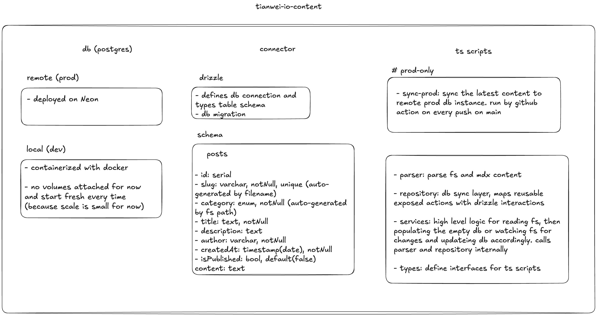

<!-- markdownlint-disable MD007 MD033 MD041 -->
<samp>
<h1>tianwei-io-content</h1>

[](https://github.com/notbd/tianwei-io-content/actions/workflows/ci.yml)
[](https://github.com/notbd/tianwei-io-content/actions/workflows/deploy-content.yml)

The content engine of my personal website [tianwei.io](https://tianwei.io).

<h2>Stack</h2>

- **Runtime**: [Node.js](https://nodejs.org) + [TypeScript](https://www.typescriptlang.org)
- **ORM**: [Drizzle ORM](https://orm.drizzle.team)
- **Database**: [PostgreSQL](https://www.postgresql.org)
- **Remote DB Host**: [Neon](https://neon.com)
- **Content Format**: [MDX](https://mdxjs.com) files with frontmatter
- **Testing**: [Vitest](https://vitest.dev) + [PGlite](https://pglite.dev) (in-memory Postgres)
- **Infrastructure**: [Docker](https://www.docker.com) Compose (local Postgres), [GitHub Actions](https://docs.github.com/en/actions) (CI + remote sync)

<h2>Site Architecture</h2>

- **[Frontend](https://github.com/notbd/tianwei.io)**: a Next.js application rendering content from the API with static generation and on-demand revalidation.
- **[API Layer](https://github.com/notbd/tianwei-io-api)**: a Hono service on Cloudflare Workers serving content data from the content engine via REST endpoints.
- **[Content Engine](https://github.com/notbd/tianwei-io-content)**: this repo, which stores, parses and syncs MDX to a remote PostgreSQL database.

<h2>Overview</h2>



> Historical sketch from the original design; some details have since
> evolved (category is now `varchar`, `updated_at` exists, sync is one
> transactional reconcile in `src/`). The sections below are the current
> source of truth.

<h2>Layout</h2>

| Path | Purpose |
| --- | --- |
| `content/{category}/{slug}.mdx` | The content itself; folder name → category, filename → slug |
| `src/` | Library code: parsing and validation, transactional sync, file watcher, the deploy's calls to the frontend |
| `drizzle/` | Database schema + committed migration history (`migrations/`) |
| `scripts/` | Thin CLI entry points (local dev, prod sync, frontend revalidation) |
| `tests/` | Vitest suite: unit (parser, dates, path structure) + integration (migration chain, sync, watcher; all against PGlite) |

<h2>Sync Semantics</h2>

A sync is a single **transactional reconcile** (`src/sync.ts`):

- Every `.mdx` file is parsed and validated first: any invalid file aborts the run before the database is touched. Frontmatter follows a strict schema (an unknown key such as a typo'd `updateAt` is an error, not silently dropped; titles and descriptions may not contain control characters, which would break the RSS feed), and the MDX body must compile with the parser the frontend uses and contain no JavaScript (imports, exports, `{expressions}`, expression props), which the frontend refuses to run. Errors name the file and line.
- Inside one transaction: all parsed posts are upserted (keyed on slug, so ids stay stable) and rows whose files no longer exist are deleted.
- Readers never observe an empty or partially-synced table; renames can't leave orphaned rows.
- Concurrent syncs (e.g. a manual `sync:prod` during a deploy) are serialized by a transaction-scoped Postgres advisory lock, so they never interleave.
- A parse that yields zero posts is rejected unless `--allow-empty` is passed, so a bad checkout can never wipe the production table.
- `createdAt` frontmatter is a calendar date written as `yyyy-MM-dd` and authored in **`CONTENT_TIME_ZONE`** (`America/New_York`, see `src/config.ts`); it is stored as the UTC instant of that zone's midnight, deterministic regardless of machine timezone. Any other form, and impossible dates such as `2024-02-30`, fail the parse and abort the sync. Optional `updatedAt` follows the same rules and must not precede `createdAt`. See [ADR-0003](./docs/adr/0003-content-time-zone.md).

Design records live in [`docs/adr/`](./docs/adr/).

<h2>Local Run</h2>

Prerequisites: **Node.js 26** (see `.nvmrc`), **pnpm 10**, and **Docker**.

```shell
git clone git@github.com:notbd/tianwei-io-content.git
cd tianwei-io-content
cp .env.example .env.local # then fill in values
pnpm install

# Start local Postgres in Docker, sync content, and watch for changes
pnpm dev:up

# After finishing, shut everything down cleanly
pnpm dev:down
```

After `pnpm dev:up`:

- A fresh Postgres container is started and exposed at `localhost:5431`.
- All `.mdx` files are reconciled into the `posts` table.
- A watcher (chokidar, debounced) re-reconciles on every content change.

<h2>Scripts</h2>

| Script | Purpose |
| --- | --- |
| `pnpm dev:up` / `dev:down` / `dev:reset` | Local Postgres lifecycle + sync + watch |
| `pnpm new-post "Title" [category]` | Scaffold a draft (`isPublished: false`, today's date in `CONTENT_TIME_ZONE`) that already passes the parser |
| `pnpm content:sync` | One-shot local reconcile (no watcher) |
| `pnpm sync:prod` | Production reconcile (requires `DATABASE_URL`) |
| `pnpm db:generate` / `db:migrate` | Generate a migration from schema changes / apply pending migrations |
| `pnpm frontend:revalidate` | Revalidate the frontend's content cache (twice, a minute apart), then check that every page renders |
| `pnpm lint` / `typecheck` / `test` | Quality gates (same as CI) |

<h2>Env Configuration</h2>

See `.env.example` for the full annotated list. Locally, `LOCAL_*` variables drive the Docker Postgres. In CI, the deploy workflow maps repository secrets to env: `PROD_REMOTE_DATABASE_URL` → `DATABASE_URL`, plus `FRONTEND_URL` and `REVALIDATION_SECRET`.

<h2>Content Sync to Prod</h2>

Production sync is fully automated:

- CI (`.github/workflows/ci.yml`) runs lint, typecheck and tests on every pull request.
- CI also parses every committed post (`tests/unit/committed-content.test.ts`), so an invalid one fails its pull request instead of the production deploy.
- On every push to `main` touching content or sync code, `.github/workflows/deploy-content.yml` re-runs the checks, refuses any commit that is not the head of `main` (re-running an old deploy would roll the content back; revert instead), applies pending migrations (`drizzle-kit migrate`: the committed history under `drizzle/migrations/`), performs the transactional reconcile against Neon, and runs `pnpm frontend:revalidate`: it revalidates the frontend cache, revalidates again a minute later (for any render that read the old rows mid-sync), and requests every page in the sitemap, failing unless each answers 200. Deploys are serialized via a concurrency group.

Result: the **remote database is always in sync** with the MDX content stored in the `main` branch of this repo.

<h2>License</h2>

Source code is licensed under <a href='./LICENSE'>AGPLv3</a>,<br>
The content is licensed under <a href='https://creativecommons.org/licenses/by-nc-sa/4.0/'>CC BY-NC-SA 4.0</a>.
</samp>
